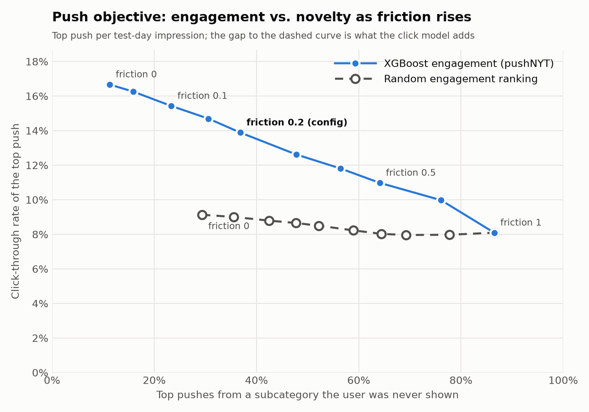

# pushNYT

Push notification engine that could be utilized by The New York Times product. Balances engagement, discovery, and editorial judgment. Built as final project for AC215: MLOps and LLMOps: Production AI Systems at Harvard. Utilized Anthropic's Claude Code Pro.

## Overview

pushNYT predicts whether a reader will click on a given article if it is pushed to them in a
given time slot, `P(click | user, article, time slot)`. Slots are:

| Slot      | Hours (local) |
|-----------|---------------|
| morning   | 05:00–11:59   |
| afternoon | 12:00–16:59   |
| evening   | 17:00–04:59   |

The model is an XGBoost classifier trained on the
[Microsoft News Dataset (MIND)](https://msnews.github.io/), with article abstracts embedded into
a local [Chroma](https://www.trychroma.com/) vector database to power retrieval-based features.

## Pipeline

```
gs://pushnyt-data ──sync-data.sh──▶ data/
                                     │
          news.tsv ──pushnyt-embed──▶ data/chroma   (MiniLM abstract embeddings)
                                     │
 behaviors.tsv + news.tsv + entity embeddings + chroma
                                     │
                              pushnyt-train            (train container)
                                     │
                                     ▼
          outputs/<run>/  (model, metrics, feature importance, predictions.parquet)
                                     │
                            pushnyt-objective          (objective container)
                                     │
                                     ▼
          outputs/<run>/objective/  (engagement-vs-novelty tradeoff, chosen pushes)
```

1. **Sync data** — `scripts/sync-data.sh` pulls the MIND files from the project's GCS bucket.
2. **Embed** — `pushnyt-embed` encodes every article abstract (falling back to the title when
   the abstract is empty) with `sentence-transformers/all-MiniLM-L6-v2` and stores the vectors
   in Chroma (`data/chroma`, collection `abstracts`).
3. **Train** — `pushnyt-train` builds features, trains XGBoost with early stopping, evaluates on
   a held-out day, and writes artifacts to `outputs/<run>/`, including per-candidate test-set
   predictions in `predictions.parquet`.
4. **Objective** — `pushnyt-objective` re-ranks those predictions with the push objective below
   (engagement vs. novelty, set by a friction parameter). It runs in its own lightweight image, so
   friction can be changed in seconds without retraining.

### Time-based split

All splits are by time so the model never sees the future:

- impressions before `split.fit_end` are used only to fit complement statistics and user history;
- `[fit_end, train_end)` trains the model (the latest `model.valid_fraction` is held out for early stopping);
- impressions at or after `split.train_end` form the test set.

Every per-user temporal feature uses only impressions strictly before the current one.

### Features

Defined in `src/pushnyt/features.py`, in seven groups:

| Group | Features | Idea |
|-------|----------|------|
| Time-slot engagement | `slot`, `slot_prior_impr`, `slot_prior_clicks`, `slot_engaged_rate`, `slot_click_share` | How the user has engaged in this slot before; rates are shrunk toward the global rate |
| Similarity | `sim_text`, `sim_entity`, `subcat_affinity` | Candidate vs. reading history via TF-IDF/SVD text vectors, TransE entity vectors, and subcategory mix |
| Complementarity | `complement_score` | Alibaba-style `s_ab = p_ab − q_ab` over subcategories ([background](https://eugeneyan.com/writing/push/)) — what users read *next*, not what is merely similar |
| Push fatigue | `slot_skipped_72h`, `slot_skip_rate_72h`, `impr_last_24h`, `hours_since_last_impr`, `hours_since_last_slot_impr` | Recent skips and overall notification volume |
| Embedding retrieval | `emb_sim_mean`, `emb_sim_max`, `emb_sim_top5`, `emb_n_close`, `emb_retrieval_rank` | Candidate vs. history in abstract-embedding space, plus its rank among the user's nearest neighbors in Chroma |
| Article recency | `article_age_hours` | Hours since the article was first shown in any impression — a proxy for publish time, which MIND lacks. Articles in a pre-period click history are capped at the start of the log, so their age is a lower bound |
| User depth | `user_history_len`, `user_prior_impr` | How much we know about the user: clicks in their pre-period history (0 = cold start, long-time readers are high) and impressions logged so far across all slots |

### Evaluation

`metrics.json` reports overall AUC, log loss, CTR, **group AUC** (mean AUC within impressions
that contain both a click and a non-click — MIND's standard metric), and AUC broken out by
time slot.

It also reports bootstrap confidence intervals (`ci`) for AUC, group AUC, and AUC by slot.
Whole impressions are resampled, since the candidates shown together are correlated, and each
replicate reweights the rows by how often its impression was drawn. The number of replicates and
the interval level are set under `evaluation` in `configs/train.yml` (`bootstrap_samples: 0` skips this).

### Results

Test day (2019-11-14, 1.22M candidate rows), embedding retrieval excluded from both runs, 95%
impression-level bootstrap CIs (1,000 replicates):

| Metric | Baseline (`baseline-no-emb`) | + recency & user depth (`recency-depth-no-emb`) |
|--------|------------------------------|-------------------------------------------------|
| AUC | 0.646 (0.644–0.649) | **0.656** (0.653–0.659) |
| Group AUC | 0.617 (0.614–0.620) | **0.622** (0.619–0.625) |
| Log loss | 0.1571 | **0.1566** |
| AUC, morning | 0.654 (0.651–0.658) | **0.669** (0.665–0.673) |
| AUC, afternoon | 0.634 (0.629–0.640) | **0.639** (0.633–0.644) |
| AUC, evening | 0.642 (0.635–0.648) | **0.645** (0.638–0.651) |

`article_age_hours` ranks third by gain, behind `subcat_affinity` and `sim_text`.

### Push objective

The click model answers "will they click?"; the push objective decides what to actually send.
For each candidate in an impression:

```
score = (1 − friction) · engagement + friction · novelty,     friction ∈ [0, 1]
```

- **engagement** — the XGBoost `P(click)`.
- **novelty** — `1 − share of the user's earlier exposure in the candidate's subcategory`, where
  exposure is their pre-period history clicks plus every article shown in earlier impressions.
  1 = a subcategory they have never been shown; near 0 = what they are usually shown.

**Putting the two halves on the same scale.** The raw values are not comparable: `P(click)` sits in
a narrow band near the base CTR (~0.04), while novelty spans 0–1 (and is close to 1 for most
subcategories). Adding them raw would let novelty swamp engagement at almost any friction, and
the meaning of a given friction would shift whenever the model's calibration changed. So each half
is converted to its **percentile rank among the candidates in the same impression** — the set we
choose one push from. Both then mean "the share of the other candidates this one beats", on the
same 0–1 scale, and friction becomes a literal weight between two rankings: at 0.2, the push is
80% "most likely to be clicked" and 20% "least like what they usually get". Ranks also make the
objective unaffected by any monotone rescaling of `P(click)` (e.g. recalibration).

**Baseline click rates.** Clicks are rare. On the test day (30,270 impressions, 1.22M candidates):

| What | Click rate |
|------|------------|
| Any single candidate shown | 3.8% |
| One candidate picked at random from each impression | 9.1% |
| The model's top pick per impression (friction 0) | 16.7% |

A random pick beats the per-candidate rate because MIND only logs impressions with at least one
click, and short impressions have a high click share (impressions hold 40 candidates on average,
median 27). So 9.1% is the fair "pick one push at random" baseline, and the click model nearly
doubles it. MIND impressions are on-site feed impressions rather than push notifications, so
absolute push click rates in production would be lower.

**The trade-off.** `pushnyt-objective` sweeps friction and plots, for the single top push per
impression, the click rate against the share of pushes from a never-shown subcategory. The dashed
curve repeats the same objective with the click model swapped for a random ranking, so the gap
between the curves is what the model adds at each level of novelty (`recency-depth-no-emb` model):



| Friction | CTR of top pick | …with random engagement | Top pick from a never-shown subcategory |
|----------|-----------------|-------------------------|-----------------------------------------|
| 0 | 16.7% | 9.1% | 11% |
| 0.05 | 16.3% | 9.0% | 16% |
| 0.1 | 15.4% | 8.8% | 23% |
| 0.15 | 14.7% | 8.7% | 31% |
| 0.2 (default) | 13.9% | 8.5% | 37% |
| 0.3 | 12.6% | 8.2% | 48% |
| 0.4 | 11.8% | 8.0% | 56% |
| 0.5 | 11.0% | 8.0% | 64% |
| 0.7 | 10.0% | 8.0% | 76% |
| 1 | 8.1% | 8.1% | 87% |

The never-shown share in the third column is for the model; under random engagement it is higher
at low friction (29% at friction 0), since a random ranking ignores the user's habits. The two
curves meet at friction 1, where engagement is ignored. Low friction buys a lot of novelty cheaply:
going from 0 to 0.2 more than triples the never-shown share for about 3 points of CTR. Above
roughly 0.5 the model keeps less and less of its edge. CTR is measured against logged clicks, so
it only credits pushes that were in the original candidate set, which likely understates how
novel pushes would do.

## Repository layout

```
configs/train.yml       # all data, split, feature, embedding, and model settings
configs/objective.yml   # push objective: which run to re-rank, friction, sweep
scripts/sync-data.sh    # pull gs://pushnyt-data into ./data
src/pushnyt/
  data.py               # MIND loaders, time-slot bucketing
  embed.py              # pushnyt-embed: abstract embeddings -> Chroma
  vectordb.py           # thin Chroma wrapper (add / fetch vectors / nearest neighbors)
  features.py           # feature engineering
  train.py              # pushnyt-train: fit, evaluate, save artifacts
  objective.py          # pushnyt-objective: engagement vs. novelty re-ranking
  plots.py              # feature-importance chart
Dockerfile              # training image (torch, xgboost, chroma: the `train` extra)
Dockerfile.objective    # objective image (numpy, pandas, pyarrow only)
docker-compose.yml, docker-shell.sh
data/                   # git-ignored; populated by sync-data.sh and pushnyt-embed
outputs/                # git-ignored; one folder of artifacts per run
```

## Getting started

### Prerequisites

- Docker (with Compose v2)
- [Google Cloud CLI](https://cloud.google.com/sdk/docs/install), authenticated with access to
  `gs://pushnyt-data` (`gcloud auth login`)

### Containers

```bash
./scripts/sync-data.sh            # pull gs://pushnyt-data into ./data (needs gcloud auth)
./docker-shell.sh                 # build image + interactive shell
docker compose run --rm train     # build + run training with configs/train.yml
docker compose run --rm objective # build + run the push objective with configs/objective.yml
docker compose run --rm shell     # interactive shell via compose (training image)
```

There are two images. `pushnyt-train` holds the heavy training stack (`pip install .[train]`);
`pushnyt-objective` holds only the core dependencies and mounts just `src/`, `configs/`, and
`outputs/`. The only thing passed between them is a run's `predictions.parquet`.

`src/`, `configs/`, `data/`, and `outputs/` are bind-mounted, so code and config edits
take effect without rebuilding. Rebuild after changing `pyproject.toml`.

### Running the pipeline

Build the vector database once (and again whenever `news.tsv` or the embedding model changes),
then train:

```bash
docker compose run --rm train "pushnyt-embed --config configs/train.yml"
docker compose run --rm train
```

Or, from inside a container shell:

```bash
pushnyt-embed --config configs/train.yml
pushnyt-train --config configs/train.yml
```

Training fails with `run pushnyt-embed first` if the Chroma collection is missing. The vector
database is only needed for the embedding retrieval features, so training without them skips it
(see below).

### Training options

```bash
# drop features for an ablation and write artifacts to their own folder
pushnyt-train --config configs/train.yml \
  --exclude sim_text emb_retrieval_rank \
  --output-dir outputs/ablation-no-text

# train without the embedding retrieval group (no vector database needed)
pushnyt-train --config configs/train.yml \
  --exclude emb_sim_mean emb_sim_max emb_sim_top5 emb_n_close emb_retrieval_rank \
  --output-dir outputs/recency-depth-no-emb
```

Hyperparameters, split dates, and feature settings all live in `configs/train.yml`. The resolved
config is copied into the output directory with each run.

### Objective options

```bash
# re-rank a run's predictions at a different friction (no retraining)
docker compose run --rm objective \
  "pushnyt-objective --run-dir outputs/recency-depth-no-emb --friction 0.3"
```

`run_dir`, `friction`, the friction `sweep`, and the random baseline's `seed` default from
`configs/objective.yml`.

### Outputs

Each run writes to its own folder under `outputs/`, `outputs/full` by default (`output.dir` in the
config, or `--output-dir`):

```
outputs/
  baseline-no-emb/        # original groups minus embedding retrieval
  recency-depth-no-emb/   # adds article recency + user depth, minus embedding retrieval
  full/                   # default: every feature group
```

| File | Contents |
|------|----------|
| `xgb_click.json` | Trained XGBoost model |
| `metrics.json` | Test-set AUC, group AUC, log loss, CTR, AUC by slot, bootstrap CIs, best iteration |
| `feature_importance.csv` | Gain per feature |
| `feature_importance.png` | Feature-importance chart, colored by feature group |
| `config.yml` | Config used for the run |
| `predictions.parquet` | Test-set candidates: impression, user, slot, article, label, `p_click`, `novelty` |
| `objective/tradeoff.csv` | Top-pick CTR and novelty at each friction, for the model and the random-ranking baseline |
| `objective/tradeoff.png` | Trade-off plot: top-pick CTR vs. never-shown share, model vs. random |
| `objective/pushes.parquet` | The chosen push per impression at the configured friction, with its score |
| `objective/summary.json` | Tradeoff row for the configured friction |

## Status and contact

These programs are a work in progress, as we work to improve usability, error-catching, and speed of analysis. If you find errors, please contact Justin Sheen at justinksheen (at) gmail (dot) com

Last Update: October 30, 2026
