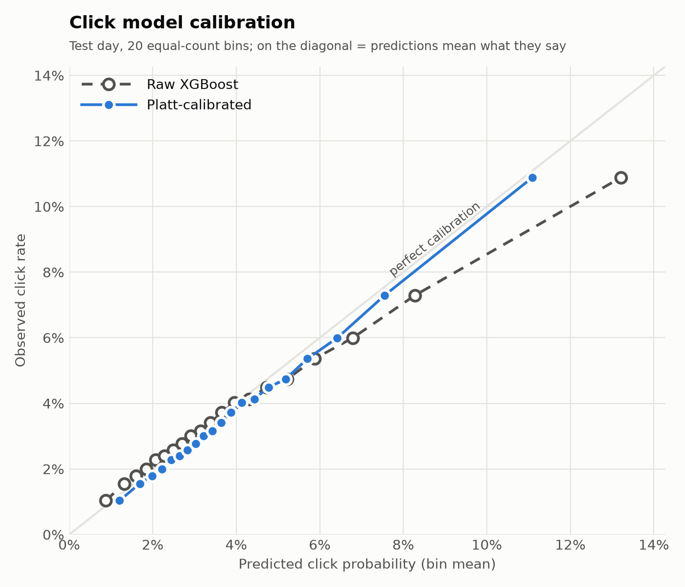
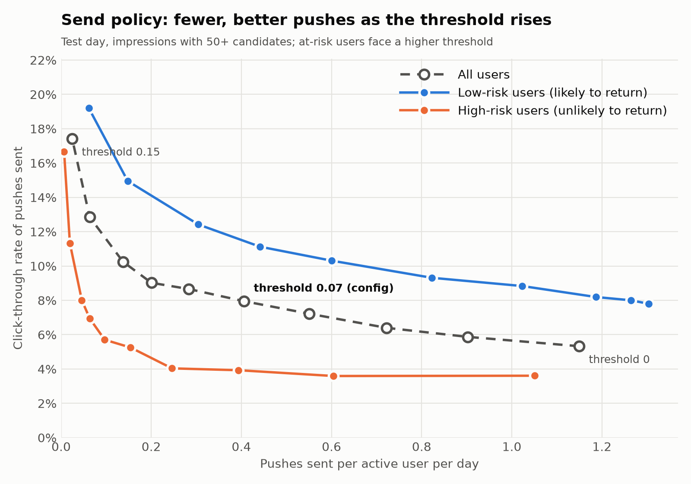
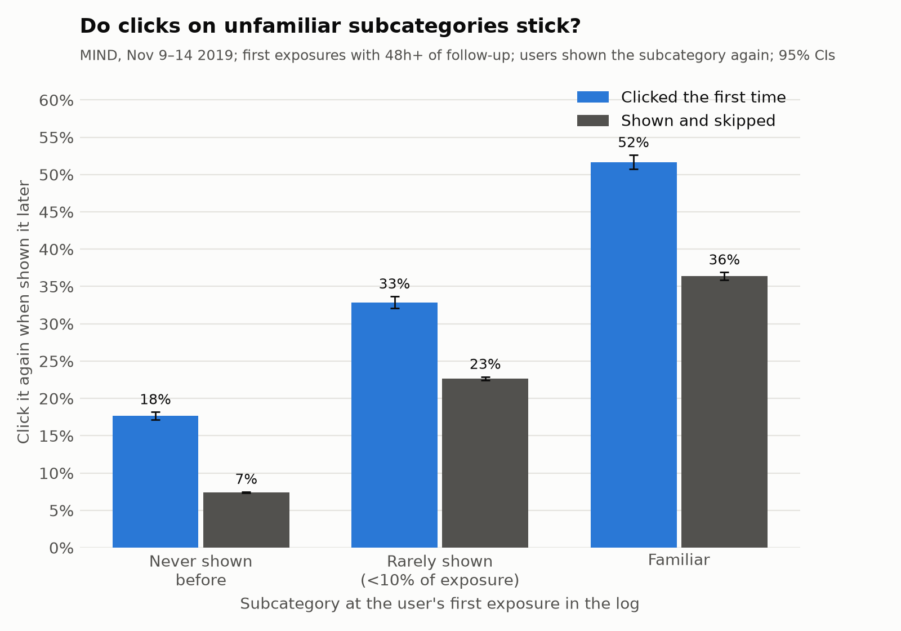
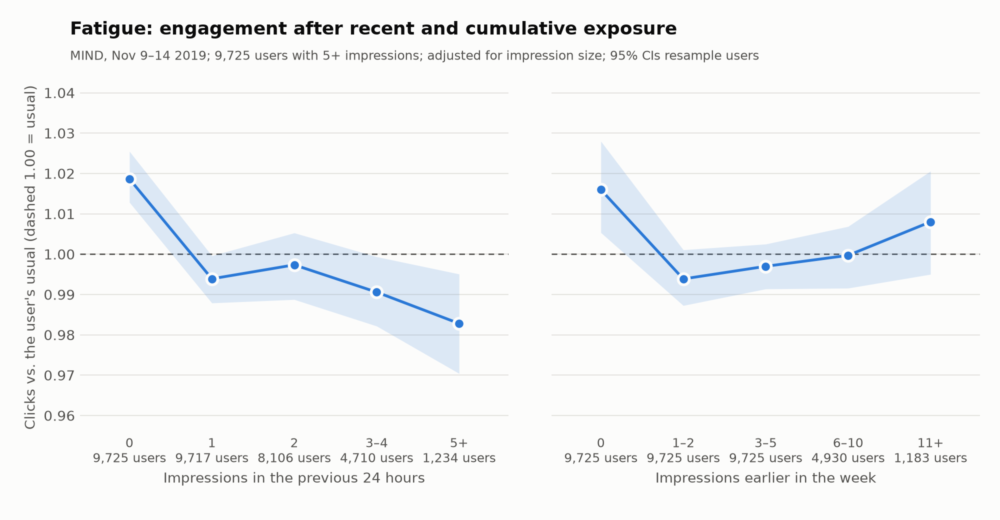

# pushNYT

[](https://github.com/jsheen/pushNYT/actions/workflows/ci.yml)

Push notification engine that could be utilized by The New York Times product. Balances engagement, discovery, and editorial judgment. Built as final project for AC215: MLOps and LLMOps: Production AI Systems at Harvard. Utilized Anthropic's Claude Code Pro.

## Overview

pushNYT predicts whether a reader will click on a given article if it is pushed to them in a
given time slot, `P(click | user, article, time slot)`. Slots are:

| Slot      | Hours (local) |
|-----------|---------------|
| morning   | 05:00–11:59   |
| afternoon | 12:00–16:59   |
| evening   | 17:00–04:59   |

The model is an XGBoost classifier trained on the
[Microsoft News Dataset (MIND)](https://msnews.github.io/), with article abstracts embedded into
a local [Chroma](https://www.trychroma.com/) vector database to power retrieval-based features.

## Pipeline

```
gs://pushnyt-data ──sync-data.sh──▶ data/
                                     │
          news.tsv ──pushnyt-embed──▶ data/chroma   (MiniLM abstract embeddings)
                                     │
 behaviors.tsv + news.tsv + entity embeddings + chroma
                                     │
                              pushnyt-train            (train container)
                                     │
                                     ▼
          outputs/<run>/  (click model + calibration, return model, metrics, predictions.parquet)
                                     │
                            pushnyt-objective          (objective container)
                                     │
                                     ▼
          outputs/<run>/objective/  (engagement-vs-novelty tradeoff, send policy, chosen pushes)

          outputs/<run>/predictions.parquet ──▶ pushnyt-api  (api container, :8000)
```

1. **Sync data** — `scripts/sync-data.sh` pulls the MIND files from the project's GCS bucket.
2. **Embed** — `pushnyt-embed` encodes every article abstract (falling back to the title when
   the abstract is empty) with `sentence-transformers/all-MiniLM-L6-v2` and stores the vectors
   in Chroma (`data/chroma`, collection `abstracts`).
3. **Train** — `pushnyt-train` builds features, trains XGBoost with early stopping, calibrates its
   probabilities, fits a return model (a churn proxy), evaluates on a held-out day, and writes
   artifacts to `outputs/<run>/`, including per-candidate test-set predictions in `predictions.parquet`.
4. **Objective** — `pushnyt-objective` picks one push per impression with the push objective below
   (engagement vs. novelty, set by a friction parameter), then decides whether to send it (a
   calibrated, risk-adjusted threshold and a daily cap). It runs in its own lightweight image, so
   both can be changed in seconds without retraining.
5. **Serve** — `pushnyt-api` exposes scores and push decisions over HTTP (see [API](#api)).

### Time-based split

All splits are by time so the model never sees the future:

- impressions before `split.fit_end` are used only to fit complement statistics and user history;
- `[fit_end, train_end)` trains the model (the latest `model.valid_fraction` is held out for early stopping);
- impressions at or after `split.train_end` form the test set.

Every per-user temporal feature uses only impressions strictly before the current one.

### Features

Defined in `src/pushnyt/features.py`, in seven groups:

| Group | Features | Idea |
|-------|----------|------|
| Time-slot engagement | `slot`, `slot_prior_impr`, `slot_prior_clicks`, `slot_engaged_rate`, `slot_click_share` | How the user has engaged in this slot before; rates are shrunk toward the global rate |
| Similarity | `sim_text`, `sim_entity`, `subcat_affinity` | Candidate vs. reading history via TF-IDF/SVD text vectors, TransE entity vectors, and subcategory mix |
| Complementarity | `complement_score` | Alibaba-style `s_ab = p_ab − q_ab` over subcategories ([background](https://eugeneyan.com/writing/push/)) — what users read *next*, not what is merely similar |
| Push fatigue | `slot_skipped_72h`, `slot_skip_rate_72h`, `impr_last_24h`, `hours_since_last_impr`, `hours_since_last_slot_impr` | Recent skips and overall notification volume |
| Embedding retrieval | `emb_sim_mean`, `emb_sim_max`, `emb_sim_top5`, `emb_n_close`, `emb_retrieval_rank` | Candidate vs. history in abstract-embedding space, plus its rank among the user's nearest neighbors in Chroma |
| Article recency | `article_age_hours` | Hours since the article was first shown in any impression — a proxy for publish time, which MIND lacks. Articles in a pre-period click history are capped at the start of the log, so their age is a lower bound |
| User depth | `user_history_len`, `user_prior_impr` | How much we know about the user: clicks in their pre-period history (0 = cold start, long-time readers are high) and impressions logged so far across all slots |

### Evaluation

`metrics.json` reports overall AUC, log loss, CTR, **group AUC** (mean AUC within impressions
that contain both a click and a non-click — MIND's standard metric), and AUC broken out by
time slot.

It also reports bootstrap confidence intervals (`ci`) for AUC, group AUC, and AUC by slot.
Whole impressions are resampled, since the candidates shown together are correlated, and each
replicate reweights the rows by how often its impression was drawn. The number of replicates and
the interval level are set under `evaluation` in `configs/train.yml` (`bootstrap_samples: 0` skips this).

**Quality gate.** If test AUC falls below `evaluation.min_auc` (0.644, the lower bound of the
baseline's 95% CI), `pushnyt-train` exits with an error after saving its artifacts, so a regression
can't pass silently but the failed run can still be inspected. Remove the setting to disable it.

### Results

Test day (2019-11-14, 1.22M candidate rows), embedding retrieval excluded from both runs, 95%
impression-level bootstrap CIs (1,000 replicates):

| Metric | Baseline (`baseline-no-emb`) | + recency & user depth (`recency-depth-no-emb`) |
|--------|------------------------------|-------------------------------------------------|
| AUC | 0.646 (0.644–0.649) | **0.656** (0.653–0.659) |
| Group AUC | 0.617 (0.614–0.620) | **0.622** (0.619–0.625) |
| Log loss | 0.1571 | **0.1566** |
| AUC, morning | 0.654 (0.651–0.658) | **0.669** (0.665–0.673) |
| AUC, afternoon | 0.634 (0.629–0.640) | **0.639** (0.633–0.644) |
| AUC, evening | 0.642 (0.635–0.648) | **0.645** (0.638–0.651) |

`article_age_hours` ranks third by gain, behind `subcat_affinity` and `sim_text`.

### Push objective

The click model answers "will they click?"; the push objective decides what to actually send.
For each candidate in an impression:

```
score = (1 − friction) · engagement + friction · novelty,     friction ∈ [0, 1]
```

- **engagement** — the XGBoost `P(click)`.
- **novelty** — `1 − share of the user's earlier exposure in the candidate's subcategory`, where
  exposure is their pre-period history clicks plus every article shown in earlier impressions.
  1 = a subcategory they have never been shown; near 0 = what they are usually shown.

**Putting the two halves on the same scale.** The raw values are not comparable: `P(click)` sits in
a narrow band near the base CTR (~0.04), while novelty spans 0–1 (and is close to 1 for most
subcategories). Adding them raw would let novelty swamp engagement at almost any friction, and
the meaning of a given friction would shift whenever the model's calibration changed. So each half
is converted to its **percentile rank among the candidates in the same impression** — the set we
choose one push from. Both then mean "the share of the other candidates this one beats", on the
same 0–1 scale, and friction becomes a literal weight between two rankings: at 0.2, the push is
80% "most likely to be clicked" and 20% "least like what they usually get". Ranks also make the
objective unaffected by any monotone rescaling of `P(click)` (e.g. recalibration).

**Baseline click rates.** Clicks are rare. On the test day (30,270 impressions, 1.22M candidates):

| What | Click rate |
|------|------------|
| Any single candidate shown | 3.8% |
| One candidate picked at random from each impression | 9.1% |
| The model's top pick per impression (friction 0) | 16.7% |

A random pick beats the per-candidate rate because MIND only logs impressions with at least one
click, and short impressions have a high click share (impressions hold 40 candidates on average,
median 27). So 9.1% is the fair "pick one push at random" baseline, and the click model nearly
doubles it. MIND impressions are on-site feed impressions rather than push notifications, so
absolute push click rates in production would be lower.

**The trade-off.** `pushnyt-objective` sweeps friction and plots, for the single top push per
impression, the click rate against the share of pushes from a never-shown subcategory. The dashed
curve repeats the same objective with the click model swapped for a random ranking, so the gap
between the curves is what the model adds at each level of novelty (`recency-depth-no-emb` model):


| Friction | CTR of top pick | …with random engagement | Top pick from a never-shown subcategory |
|----------|-----------------|-------------------------|-----------------------------------------|
| 0 | 16.7% | 9.1% | 11% |
| 0.05 | 16.3% | 9.0% | 16% |
| 0.1 | 15.4% | 8.8% | 23% |
| 0.15 | 14.7% | 8.7% | 31% |
| 0.2 (default) | 13.9% | 8.5% | 37% |
| 0.3 | 12.6% | 8.2% | 48% |
| 0.4 | 11.8% | 8.0% | 56% |
| 0.5 | 11.0% | 8.0% | 64% |
| 0.7 | 10.0% | 8.0% | 76% |
| 1 | 8.1% | 8.1% | 87% |

The never-shown share in the third column is for the model; under random engagement it is higher
at low friction (29% at friction 0), since a random ranking ignores the user's habits. The two
curves meet at friction 1, where engagement is ignored. Low friction buys a lot of novelty cheaply:
going from 0 to 0.2 more than triples the never-shown share for about 3 points of CTR. Above
roughly 0.5 the model keeps less and less of its edge. CTR is measured against logged clicks, so
it only credits pushes that were in the original candidate set, which likely understates how
novel pushes would do.

### Calibration

A ranking only needs scores in the right order. A **send/don't-send decision** needs them to be
right in absolute terms: of all pushes scored 0.10, about 10% should be clicked. That property is
calibration, and models trained for ranking often lack it (gradient boosting with early stopping
tends to be over- or under-confident in the tails).

`pushnyt-train` applies **Platt scaling**: it fits `p = sigmoid(a · logit(raw) + b)` on the
held-out early-stopping slice and applies it to the test day. The mapping is strictly increasing,
so rankings, AUC, and the push objective's choices are unchanged; only the probability scale
moves. (Isotonic regression is the more flexible alternative, but it creates ties, which would
change the objective's rankings.)



| | Raw XGBoost | Calibrated |
|---|---|---|
| Expected calibration error (ECE) | 0.35 pts | **0.24 pts** |
| Brier score | 0.03635 | **0.03630** |
| Top bin: predicted → observed | 13.2% → 10.9% | **11.1% → 10.9%** |

On average the raw model was already close; the fix matters at the top, where it was
**overconfident**, and the top is exactly where a send threshold operates. ECE is the
count-weighted mean gap between predicted and observed rates over 20 equal-count bins.

**A MIND caveat.** Calibration is per *candidate*. It does not make the *chosen* push calibrated,
because MIND only logs impressions that contain a click: in impressions with ≤10 candidates, 18.6%
of candidates are clicked (the model predicts 4.8%); with >100, 1.9% (it predicts 3.8%). The model
cannot see impression size, and real pushes have no guaranteed click. So the send policy below is
evaluated on impressions with 50+ candidates, where the artifact is weakest; within those, the
model's top picks still click at a higher rate as its prediction rises (3.6% → 8.5% across
quintiles), though it over-predicts their level.

### Return model (churn proxy)

The real cost of a bad push is a reader turning notifications off. MIND has no opt-out events, so
`pushnyt-train` fits a proxy: **P(the user has another impression within 24 hours)**, an XGBoost
model on user depth and fatigue features (`src/pushnyt/risk.py`). Risk = 1 − P(return).

- Labels are censored near the end of the log, so it trains on impressions before `fit_end`,
  is evaluated on `[fit_end, train_end)` (**AUC 0.743**, 54% return rate), and only scores the test day.
- It is a **user-level** signal: it mostly measures how active someone is, not what a push did to
  them. Subtracting it from the per-article score would barely change which article wins (it is
  nearly constant within an impression), so it sets **how much** to send each user, not **what**.

### Send policy

For each impression's top pick (at the configured friction), `pushnyt-objective` sends it only if

```
calibrated P(click) ≥ threshold + risk_penalty · (1 − P(return))
```

and the user has had fewer than `daily_cap` pushes that day (earliest first; the policy can't see
later impressions). Defaults in `configs/objective.yml`: threshold 0.07, risk penalty 0.04, cap 2.
At-risk users therefore only get pushes the model is more confident about.



On impressions with 50+ candidates:

| Threshold | Pushes per active user-day | CTR of pushes sent | Predicted CTR |
|-----------|----------------------------|--------------------|---------------|
| 0 (send all, cap 2) | 1.15 | 5.3% | 8.1% |
| 0.05 | 0.72 | 6.4% | 9.4% |
| **0.07 (default)** | **0.41** | **7.9%** | 10.9% |
| 0.10 | 0.14 | 10.3% | 13.9% |
| 0.15 | 0.02 | 17.4% | 19.1% |

Raising the threshold trades volume for quality as intended. At the default, low-risk users get
0.82 pushes/day at 9.3% CTR and high-risk users 0.15/day at 5.3%. The model over-predicts
on this slice, most for high-risk users, which is the impression-size caveat above plus a sign
that a production calibrator should be fit per user segment.

### Production: plugging in real opt-out data

In production the return proxy should be replaced by a model of actual notification opt-outs.
What NYT would need to log:

| Event | Fields | Used for |
|-------|--------|----------|
| Push sent | user, article, time, slot, model scores, **send probability** | Training data; off-policy evaluation of new policies |
| Push opened | user, article, time | The click label (replaces MIND impressions) |
| Push dismissed | user, article, time | Article-level negative feedback |
| Notifications disabled / app uninstalled | user, time, pushes in the prior 7 days | The opt-out model's label |

A user-level opt-out model drops straight into the send policy in place of `p_return`. Dismissals
and opt-outs shortly after a specific push are what an **article-level** risk term would need,
added to the score as `(1 − f) · engagement + f · novelty − λ · risk`; MIND has nothing comparable,
so that term is not built here.

### Do clicks on unfamiliar subcategories stick?

The novelty term pays a click cost now on the bet that new interests last. MIND can partly test
that bet. `pushnyt-exploration` takes each user's **first exposure** in the log to each
subcategory, notes whether they clicked it and how unfamiliar it was at that moment, and then asks:
among users shown that subcategory again later, what share click it?



| Subcategory at first exposure | Clicked the first time | Shown and skipped | Ratio |
|-------------------------------|------------------------|-------------------|-------|
| Never shown before | 17.6% | 7.4% | **2.4×** |
| Rarely shown (<10% of exposure) | 32.9% | 22.7% | 1.5× |
| Familiar | 51.7% | 36.4% | 1.4× |

(First exposures with at least 48h of log left; 20k–380k re-exposed users per bar; 95% CIs ≤ ±1 point.)

Users come back to familiar subcategories far more often, as expected. But a first click on a
**never-shown** subcategory goes with a 2.4× higher chance of clicking it again, the biggest
relative gap of the three: an unfamiliar click that lands is followed by real, repeated interest,
not just a one-off. That supports the novelty term's premise.

**Caveats.** This is observational and on feed clicks, not pushes: users who click unfamiliar
topics may simply be more curious, so it shows association, not that a push *creates* interest.
The follow-up is at most a few days, and a user can only re-click what the feed showed them again
(hence conditioning on re-exposure). The causal version is an experiment: randomize friction and
measure later organic reading of the new subcategories.

```bash
docker compose run --rm train "pushnyt-exploration"   # writes outputs/analysis/exploration.{csv,png}
```

### Fatigue: do users engage less after heavy exposure?

The send policy's daily cap assumes more pushes means less attention to each. `pushnyt-fatigue`
checks what MIND shows. Heavy users differ from light ones, so each user is compared with **their
own** usual engagement: for every impression, expected clicks = impression size × the click rate
for impressions of that size (MIND's logging inflates small ones), scaled by the user's own
actual-to-expected ratio. The index is actual ÷ expected clicks: 1.00 = usual, below = fatigued.
Users with 5+ impressions (9,725); 95% CIs resample users.



| Impressions in the previous 24h | 0 | 1 | 2 | 3–4 | 5+ |
|---|---|---|---|---|---|
| Engagement vs. usual | **1.019** | 0.994 | 0.997 | 0.991 | **0.983** |

| Impressions earlier in the week | 0 | 1–2 | 3–5 | 6–10 | 11+ |
|---|---|---|---|---|---|
| Engagement vs. usual | 1.016 | 0.994 | 0.997 | 1.000 | 1.008 |

- **Short-term fatigue is real but small.** Users engage about 2% above their norm when they have
  not been seen in the past day and about 2% below it after 5+ impressions; the intervals at the
  two ends don't overlap. Freshness matters: the first impression after a gap does best.
- **No cumulative fatigue over the week.** Engagement does not keep falling with total exposure; the
  heaviest users are back at their norm, likely because people who keep coming back are the
  engaged ones.
- **What it supports:** a *daily* cap and spacing pushes out (both in the send policy and the
  `hours_since_last_impr` feature), rather than a weekly budget.

**Caveats.** Feed impressions are started by the user, while pushes arrive unprompted, so push
fatigue is very likely stronger than this, and MIND can't show the outcome that matters most:
users turning notifications off. Six days is also short for "long term." The production version is
the volume experiment in the roadmap: randomize daily caps for several weeks and track CTR and
opt-outs over time.

```bash
docker compose run --rm train "pushnyt-fatigue"       # writes outputs/analysis/fatigue.{csv,png}
```

## Repository layout

```
configs/train.yml       # all data, split, feature, embedding, and model settings
configs/objective.yml   # push objective: which run to re-rank, friction, sweep
scripts/sync-data.sh    # pull gs://pushnyt-data into ./data
scripts/smoke-api.sh    # start the API image on a fixture run and check it responds (used by CI)
src/pushnyt/
  data.py               # MIND loaders, time-slot bucketing
  embed.py              # pushnyt-embed: abstract embeddings -> Chroma
  vectordb.py           # thin Chroma wrapper (add / fetch vectors / nearest neighbors)
  features.py           # feature engineering
  train.py              # pushnyt-train: fit, evaluate, save artifacts
  calibration.py        # Platt scaling, reliability bins, ECE
  risk.py               # return model (churn proxy)
  exploration.py        # pushnyt-exploration: do clicks on unfamiliar subcategories stick?
  fatigue.py            # pushnyt-fatigue: engagement after recent and cumulative exposure
  objective.py          # pushnyt-objective: engagement vs. novelty re-ranking + send policy
  api.py                # pushnyt-api: FastAPI serving app
  plots.py              # all charts (importance, calibration, trade-off, send policy, analyses)
tests/                  # pytest suite on synthetic MIND-style data
.github/workflows/      # ci.yml (lint, test, build images), release.yml (publish images)
Dockerfile              # training image (torch, xgboost, chroma: the `train` extra)
Dockerfile.objective    # objective image (numpy, pandas, pyarrow, matplotlib)
Dockerfile.api          # API image (core deps + the `api` extra: fastapi, uvicorn)
docker-compose.yml, docker-shell.sh
docs/                   # images used by this README
data/                   # git-ignored; populated by sync-data.sh and pushnyt-embed
outputs/                # git-ignored; one folder of artifacts per run
```

## Getting started

### Prerequisites

- Docker (with Compose v2)
- [Google Cloud CLI](https://cloud.google.com/sdk/docs/install), authenticated with access to
  `gs://pushnyt-data` (`gcloud auth login`)

### Containers

```bash
./scripts/sync-data.sh            # pull gs://pushnyt-data into ./data (needs gcloud auth)
./docker-shell.sh                 # build image + interactive shell
docker compose run --rm train     # build + run training with configs/train.yml
docker compose run --rm objective # build + run the push objective with configs/objective.yml
docker compose up -d api          # build + start the serving API on http://localhost:8000
docker compose run --rm shell     # interactive shell via compose (training image)
```

There are three images. `pushnyt-train` holds the heavy training stack (`pip install .[train]`);
`pushnyt-objective` holds only the core dependencies and mounts just `src/`, `configs/`, and
`outputs/`; `pushnyt-api` adds FastAPI to the core dependencies and mounts `outputs/` read-only.
They never call each other: the only thing passed between them is a run's
`predictions.parquet`, through the shared `outputs/` folder.

`src/`, `configs/`, `data/`, and `outputs/` are bind-mounted, so code and config edits
take effect without rebuilding. Rebuild after changing `pyproject.toml`.

### Running the pipeline

Build the vector database once (and again whenever `news.tsv` or the embedding model changes),
then train:

```bash
docker compose run --rm train "pushnyt-embed --config configs/train.yml"
docker compose run --rm train
```

Or, from inside a container shell:

```bash
pushnyt-embed --config configs/train.yml
pushnyt-train --config configs/train.yml
```

Training fails with `run pushnyt-embed first` if the Chroma collection is missing. The vector
database is only needed for the embedding retrieval features, so training without them skips it
(see below).

### Training options

```bash
# drop features for an ablation and write artifacts to their own folder
pushnyt-train --config configs/train.yml \
  --exclude sim_text emb_retrieval_rank \
  --output-dir outputs/ablation-no-text

# train without the embedding retrieval group (no vector database needed)
pushnyt-train --config configs/train.yml \
  --exclude emb_sim_mean emb_sim_max emb_sim_top5 emb_n_close emb_retrieval_rank \
  --output-dir outputs/recency-depth-no-emb
```

Hyperparameters, split dates, and feature settings all live in `configs/train.yml`. The resolved
config is copied into the output directory with each run.

### Objective options

```bash
# re-rank a run's predictions at a different friction (no retraining)
docker compose run --rm objective \
  "pushnyt-objective --run-dir outputs/recency-depth-no-emb --friction 0.3"
```

`run_dir`, `friction`, the friction `sweep`, and the random baseline's `seed` default from
`configs/objective.yml`.

### API

```bash
docker compose up -d api      # serves outputs/recency-depth-no-emb by default
PUSHNYT_RUN_DIR=outputs/full docker compose up -d api   # serve a different run
docker compose down           # stop it
```

Interactive docs are at <http://localhost:8000/docs>.

| Endpoint | Does |
|----------|------|
| `GET /health` | Liveness, plus which run is loaded |
| `GET /model` | Run name, excluded features, test metrics |
| `GET /users/{user_id}/impressions` | A user's impressions in the run, to find ids to score |
| `POST /score` | `P(click)` and novelty for an impression's candidates, highest first |
| `GET /metrics` | Prometheus metrics: requests, errors, latency, and push behavior (see Monitoring) |
| `POST /push` | The push the objective picks at a given `friction` (default 0.2), with its engagement and novelty ranks, whether the send policy would send it (`send`: decision, risk-adjusted threshold, risk), and the next four candidates |

```bash
curl localhost:8000/users/U86598/impressions
curl -X POST localhost:8000/push -H 'content-type: application/json' \
  -d '{"impression_id": 152636, "friction": 0.2}'
```

Both `POST` endpoints accept an optional `news_ids` list to restrict the choice to a subset of the
impression's candidates. Friction outside [0, 1] returns 422; unknown impressions or articles return 404.

The send decision uses the threshold and risk penalty from `configs/objective.yml`. The daily cap
needs to know what the user was already sent today, so the caller enforces it.

### Monitoring

| Layer | How |
|-------|-----|
| **Is it up?** | The API image has a Docker `HEALTHCHECK` on `/health` every 30s; `docker ps` shows `(healthy)` / `(unhealthy)`. Compose restarts the container if the process exits. |
| **Is it erroring or slow?** | `GET /metrics` (Prometheus format): `pushnyt_requests_total{endpoint,status}` and the `pushnyt_request_seconds` latency histogram. |
| **Is the model behaving sensibly?** | Also on `/metrics`: `pushnyt_push_decisions_total{decision="send"/"hold"}` (send rate), histograms of the chosen push's `p_click` and `novelty`, the friction callers ask for, and `pushnyt_model_info{run}` / `pushnyt_model_test_auc` for which model is live. |
| **What happened on a request?** | One JSON log line per request (`docker compose logs api`): endpoint, status, latency, and for `/push` the impression, friction, chosen article, `p_click`, and send decision. |

A sudden change in the send rate or the `p_click` distribution, with no change in traffic, is the
early warning that something upstream changed: a new training run, a feature bug, or a shift in
the data. Prometheus can scrape `/metrics` directly (or Google Cloud Managed Service for
Prometheus on GCP), and the JSON logs work as-is with Cloud Logging. What this can't watch is
**accuracy**: comparing predicted to actual clicks needs the outcomes of sent pushes logged and
joined back (see "Production: plugging in real opt-out data").

**Limitation:** the API serves a run's precomputed test-day predictions, so it only knows the
impressions in that run's `predictions.parquet`. Scoring live requests would need each user's
features (history, recent skips, exposure) computed online from a feature store.

## Development

### Tests

```bash
docker compose run --rm -v "$PWD/tests:/app/tests" train "uv sync --extra train --extra api --extra dev && ruff check src tests && pytest"
# or locally: uv sync --extra train --extra api --extra dev && uv run pytest
```

The suite builds a tiny synthetic MIND-style dataset (`tests/conftest.py`), so it needs no real data
or vector database. It covers the AUC/bootstrap math and quality gate, calibration (Platt keeps
rankings, fixes overconfidence), return labels and censoring, the objective (friction bounds and
endpoints, scale-invariance), the send policy (risk-adjusted threshold, daily cap order), the
no-lookahead guarantees of the recency and novelty
features, an end-to-end train → objective run, and every API endpoint.

### CI/CD

- **CI** (`.github/workflows/ci.yml`), on every push to `main` and every pull request: `ruff`,
  `pytest`, a build of all three Docker images (not pushed), and an API smoke test
  (`scripts/smoke-api.sh`) that starts the API container on a tiny fixture run and checks that
  `/health`, `/push`, and `/metrics` respond. Run it locally with `scripts/smoke-api.sh`.
- **Release** (`.github/workflows/release.yml`), when a version tag is pushed: builds the three
  images and publishes them to GitHub Container Registry as
  `ghcr.io/jsheen/pushnyt-{train,objective,api}`, tagged with the version and `latest`:

  ```bash
  git tag v0.2.0 && git push origin v0.2.0
  ```

Training on the real data is not part of CI (it needs the GCS data); the quality gate guards it when
you run it.

### Outputs

Each run writes to its own folder under `outputs/`, `outputs/full` by default (`output.dir` in the
config, or `--output-dir`):

```
outputs/
  baseline-no-emb/        # original groups minus embedding retrieval
  recency-depth-no-emb/   # adds article recency + user depth, minus embedding retrieval
  full/                   # default: every feature group
```

| File | Contents |
|------|----------|
| `xgb_click.json` | Trained XGBoost model |
| `metrics.json` | Test-set AUC, group AUC, log loss, CTR, AUC by slot, bootstrap CIs, calibration (Platt parameters, ECE, Brier before/after), return-model AUC, best iteration |
| `calibration.png` | Reliability diagram, raw vs. calibrated |
| `feature_importance.csv` | Gain per feature |
| `feature_importance.png` | Feature-importance chart, colored by feature group |
| `config.yml` | Config used for the run |
| `predictions.parquet` | Test-set candidates: impression, user, slot, article, label, `p_click` (calibrated), `p_click_raw`, `novelty`, `p_return` |
| `objective/tradeoff.csv` | Top-pick CTR and novelty at each friction, for the model and the random-ranking baseline |
| `objective/tradeoff.png` | Trade-off plot: top-pick CTR vs. never-shown share, model vs. random |
| `objective/pushes.parquet` | The chosen push per impression at the configured friction, with its score and `send` decision |
| `objective/volume.csv`, `volume.png` | Pushes per user-day vs. CTR of pushes sent at each send threshold, by risk group |
| `objective/summary.json` | Tradeoff row for the configured friction, plus send-policy results |

## Status and contact

These programs are a work in progress, as we work to improve usability, error-catching, and speed of analysis. If you find errors, please contact Justin Sheen at justinksheen (at) gmail (dot) com

Last Update: October 30, 2026
